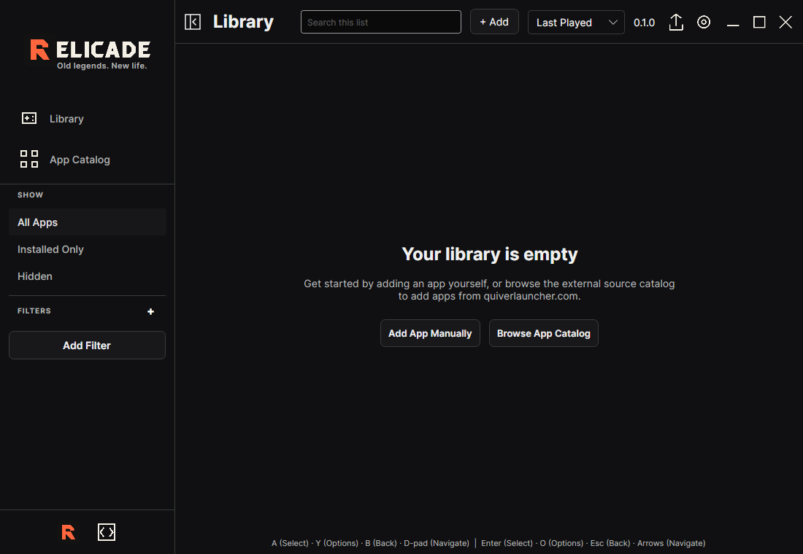

<div align="center">

<picture>
  <source media="(prefers-color-scheme: dark)" srcset="brand/readme-lockup-dark.svg">
  
</picture>

### Old legends. New life.

**A new home for games that deserve another lifetime.**

[Preview](#explore-locally) · [Product direction](docs/PRODUCT_REQUIREMENTS.md) · [Roadmap](docs/ROADMAP.md) · [Contributing](CONTRIBUTING.md)

</div>

---

## The vision

Relicade is becoming one coherent home for **community-revived classics, retro games and emulation**—including native ports, recompilations and recreations. Discover the community project behind a favourite game, understand its setup and compatibility, and keep discovery, library, setup, versions, mods, recovery and play together.

The goal is a clear path from “What can I play?” to the right version, game files, mods and recovery options. Controller-first and keyboard-complete journeys should make power features accessible, not remove them. Local and offline library use must remain possible without a required account.

Catalog coverage is part of that goal: support the full upstream community-port catalog, with project sources, setup requirements and installation and launch behavior checked per game. The twelve-project browser preview is a sample, not the finished catalog.

Emulation is **future scope, not yet implemented**. Each emulator/core needs its own licensing and compatibility review; players must supply any required game data or BIOS lawfully. Relicade will not distribute unlicensed ROMs, BIOS or keys.

## Current progress

**No packaged launcher release.** This is development source and a browser design preview, not complete functionality or accepted native platform support.

Current source also includes [guided engine-setup history](docs/GAME_SETUP.md#interrupted-guided-engine-setup): saved reviewed intent and last stage, read-only reopening, and an explicit fresh retry for supported Linux x64 first-install adapters. This is not a general download queue or automatic resume; game-file consent remains separate.

Recent merged work includes [rollback-state consistency and explicit retained-file reuse](https://github.com/MrDiamondBallz/relicade/pull/28). Earlier work adds [separate CPU-rendered native UI tests](https://github.com/MrDiamondBallz/relicade/pull/11) for the library, offline catalog and settings views. The [earlier maintenance update](https://github.com/MrDiamondBallz/relicade/pull/12) aligns the Avalonia dependencies on the official 12.1.4 patch and adds input-session cleanup and application-lifetime regressions. These changes have independent local review and test coverage; they are development milestones, not a packaged release or a claim that every target platform has been tested.

- **Merged development source:** reviewed staged installation and recovery, explicit vault-backed credential migration, offline instance shortcuts and process lifetime handling, managed-removal safeguards, and [previewed, hash-confirmed redundant-backup payload cleanup](https://github.com/MrDiamondBallz/relicade/pull/3). Cleanup retains all previous generations, data snapshots and the current operation's entire backup; it is not credential erasure, general history pruning or managed uninstall. These are bounded source milestones, not a production-safe installer or a promise of compatibility with every game. See [the earlier source milestone](https://github.com/MrDiamondBallz/relicade/pull/1) and the [native guide](native/README.md).
- **Included in this source:** the native library context menu exposes a redundant-backup preview, explicit displayed-plan confirmation, cancellation, truthful results and explicit same-plan resume. This UI is not released or native-platform accepted. **In progress:** full behavior reconciliation, packaged installation, security/rights checks and real platform/controller/accessibility acceptance remain open.
- **Longer term:** the broader retro-game and emulation experience is not yet implemented. Versions, mods, owned-data setup and recovery need complete tested player journeys, not just service code.

The library also includes **Restore previous portable version…**: an offline,
explicitly hash-confirmed preview of the immediate retained payload. Current
declared saves/data stay current; older saves are not restored and save-format
compatibility is not guaranteed. Interrupted or uncertain history requires
inspection, not preview/reopen repair or resume. A confirmed operation can attempt
transaction-internal recovery on failure; an error is not an unchanged-state or
safe-retry assurance. This is source-stage functionality,
not a packaged or native-platform acceptance claim; see the [native guide](native/README.md).

The native source includes **Finish game setup** for specific Perfect Dark and
z2rs Linux x64 packages. New dedicated Perfect Dark and z2rs entries on Linux x64
offer **Set up game** to confirm their pinned engine download before selecting a
lawful local file. Review the copy,
confirm explicitly and revalidate before launch. After a compatible generation
change, **Use retained game files…** offers separate confirmation to reuse a
verified existing copy without its original or another game-data copy. This is bounded development
source, not gameplay certification or complete project support. See
[local game-data setup](docs/GAME_SETUP.md) for the exact package and limits. The separate
**Set up / Play Freedoom Phase 2…** action can explicitly install one pinned
UZDoom Linux x64 package in a new entry, then offer a separately confirmed local
data copy or free-data download. Existing engines and normal Launch are not
replaced. The first engine setup has explicit confirmation, progress and its own
Cancel action; cancellation waits for owned work and preserves a committed engine.
Neither flow is complete catalog coverage or gameplay certification.

The browser preview supports a bounded selection of real public project metadata, search, filters, project details, keyboard navigation and browser-local saved-library bookmarks. Saved projects are not installed games. It does not install, update, verify or launch executables.

The [native development source](native/README.md) uses .NET 10/Avalonia. Linux x64 self-contained publish and isolated startup, plus Windows x64 cross-publish, are development checks only. A [private Linux x64 AppDir/AppImage recipe](docs/LINUX_APPIMAGE_DEVELOPMENT.md) is available for development, not as a supported download. The [coverage contract](docs/FEATURE_COVERAGE.md) keeps native/package acceptance separate.

<!-- docs-sync:begin facts -->
Repository facts (not acceptance results): **12 catalog projects**, **71 required feature rows**, **8 platform/package targets** and **23 synthetic fixture scenarios**. Counts describe repository inputs, not working games or passing tests.

Source status: merged development source includes [reviewed safety work](https://github.com/MrDiamondBallz/relicade/pull/3); [backup cleanup](https://github.com/MrDiamondBallz/relicade/pull/3) is recorded as merged development source, not release acceptance. No packaged release, complete-functionality acceptance or native-platform acceptance is recorded here. Emulation is planned, not implemented.
<!-- docs-sync:end facts -->

[How documentation stays current](docs/DOCUMENTATION.md): contribution-time checks and periodic maintainer reconciliation keep generated facts and source-sensitive prose under review. The tool checks facts mechanically; it does not approve prose. Cloning the repository does not install a timer or service.

### Current native application



*Actual native development interface, rendered headlessly on Linux with an empty local library and isolated test settings. Captured from native source `8a1796c` on 2026-10-23, without image edits or game artwork. This is not a browser mockup, a desktop-host check or gameplay/platform acceptance. [Capture provenance](docs/ARTWORK.md#native-capture-provenance).*

[Identity system](brand/BRAND.md) · [Brand presentation](docs/assets/relicade-brand.png) · [Architecture](docs/ARCHITECTURE.md)

## Explore locally

Requires **Python 3.10+**. The preview itself needs no package installation, account or build step.

```sh
python tools/preview.py
```

- Product preview: <http://127.0.0.1:8766/prototype/>
- Brand presentation: <http://127.0.0.1:8766/brand/>

The server binds only to loopback, serves only the preview/brand directories, rejects directory listings and applies a restrictive content security policy. Stop it with **Ctrl+C**. Clearing browser site storage removes saved preview bookmarks.

Run the server regressions:

```sh
python -m unittest discover -s tests -v
```

See [CONTRIBUTING.md](CONTRIBUTING.md) for the full developer suite and pinned dependencies. Hosted CI is not active yet; the [workflow template](docs/ci/prototype-quality.yml) is supplied without a misleading passing-build badge.

## Platform targets

These are **release requirements, not available downloads**:

- **Windows:** x64.
- **Linux:** x64 and ARM64; AppImage and Flatpak packaging.
- **macOS:** Intel x64 and Apple Silicon ARM64.
- **Android:** APK, with mobile-specific permissions, input and application launching.

Every platform needs its own package and runtime evidence. Shared-code compilation or browser emulation does not establish native compatibility. Desktop executable launching is not an Android capability.

## What comes next

The [roadmap](docs/ROADMAP.md) prioritizes real native library and readiness flows, durable downloads, recoverable upgrades, reproducible mod profiles and controller-first navigation. These remain requirements until implementation and failure-path tests pass.

## Project structure

- `brand/` — original identity masters, usage guide, tokens and licensed fonts.
- `prototype/` — browser preview, public metadata snapshot and original project tiles.
- `native/` — shared native code, desktop/Android hosts, retained license notices and native tests; see its build instructions and limitations.
- `docs/` — product requirements, architecture, roadmap and CI template.
- `tools/` — local preview and browser QA utilities.
- `tests/` — repeatable regression checks.

## Credits and rights

Community projects, game names and external metadata belong to their respective creators and rights holders. Source links and exact provenance remain available; a catalog listing is not a download license or safety endorsement. This repository contains no ROMs, BIOS, commercial game data, user credentials or copied installed executables.

See [NOTICE.md](NOTICE.md) for third-party credits and font licenses. Inherited native source retains its applicable MIT notices. Except for the narrowly scoped AppStream metadata CC0 dedication described in NOTICE, no open-source license has been selected for separately owned original Relicade material; source visibility alone is not a reuse grant.
