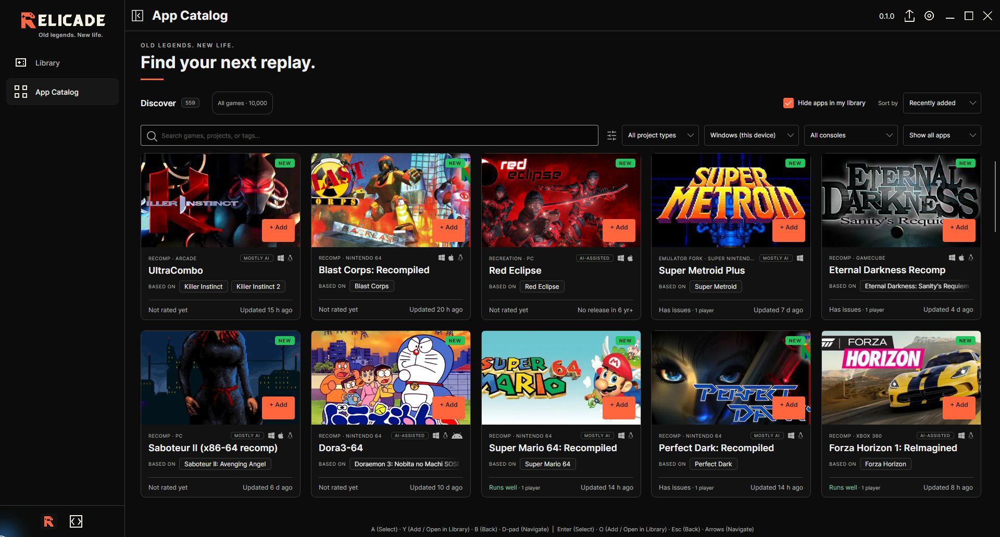

<div align="center">

<picture>
  <source media="(prefers-color-scheme: dark)" srcset="brand/readme-lockup-dark.svg">
  
</picture>

### Old legends. New life.

**A new home for games that deserve another lifetime.**

[Preview](#explore-locally) · [Product direction](docs/PRODUCT_REQUIREMENTS.md) · [Roadmap](docs/ROADMAP.md) · [Contributing](CONTRIBUTING.md)

</div>


**In development — no packaged launcher release yet.** Windows x64 is the first
release target. The image below is the real native application; source milestones
and test results are not a promise that every catalog entry is playable.

### Current native application



*Genuine native Windows development build `d092f2f`, captured on 2026-10-24 in a maximized window with an isolated empty Library. Upstream community labels are shown as reported, not Relicade gameplay certification; **All games** opens the separate offline 10,000-record metadata index. The controller R is rendered by the actual application, without image edits. It is not a mockup, a playable-game count or release acceptance. [Capture provenance](docs/ARTWORK.md#native-capture-provenance).*

The orange R now includes original retro-controller cutouts in the interface,
app icons and repository wordmarks, matching the untouched native photo above. The [earlier Linux empty-library capture](docs/assets/relicade-native-empty-8a1796c-20261023.png)
remains unchanged as historical evidence.

[Identity system](brand/BRAND.md) · [Brand presentation](docs/assets/relicade-brand.png) · [Architecture](docs/ARCHITECTURE.md)

## The vision

A native home for **community-revived classics, retro games and emulation**:
find a game, understand the community project and its requirements, and keep
setup, library, versions, mods and recovery together. Relicade aims for a smooth
controller-first experience with complete keyboard access and a local, offline
library that needs no required account.

Emulation is planned, not yet implemented. Relicade does not supply unlicensed
ROMs, BIOS or keys; game data and runtime rights remain separate from discovery.

## Current progress

**Merged development source** now includes:

- **Broad discovery:** a searchable offline snapshot of 10,000 named game records,
  with stable source identities and bounded pages. These are metadata records,
  not 10,000 verified downloads or playable games. Community projects have their
  own live catalog, requirements and readiness information.
- **A local library:** Add/Open in Library, settings, metadata export, restart
  persistence and refusal to overwrite a corrupt library have bounded native
  Windows and Linux evidence.
- **Explicit setup and recovery:** pinned engine confirmation, separate game-data
  consent, cancellation, retained generations, portable rollback and backup
  cleanup. The reviewed Windows UZDoom/Freedoom install/data journey reaches a
  separate disabled Play action; integrated Windows gameplay is still pending.
- **Controller and keyboard work:** reviewed input lifetime, rapid-edge, modal
  routing and navigation repairs. Automated checks and limited physical input
  observations do not establish complete hardware compatibility.

**In progress:** an all-in-one branded Windows setup wizard, automatic launcher
updates, big-screen mode, broader game support and remaining visual/accessibility
polish. None is an available released feature. Earlier safety milestones
([installation](https://github.com/MrDiamondBallz/relicade/pull/1),
[backup cleanup](https://github.com/MrDiamondBallz/relicade/pull/3)) and detailed
limitations remain in [development history](docs/DEVELOPMENT_MILESTONES.md),
[game setup](docs/GAME_SETUP.md) and the [native guide](native/README.md).

## Build or preview

The native desktop source uses **.NET 10 and Avalonia**. Start with the
[native build instructions](native/README.md); ordinary players should wait for
an accepted package rather than install development tools.

### Explore locally

The separate browser design preview requires **Python 3.10+**, with no account
or package installation:

```sh
python tools/preview.py
```

Open <http://127.0.0.1:8766/prototype/> or the
[brand presentation](http://127.0.0.1:8766/brand/). Stop the loopback-only server
with **Ctrl+C**. Browser bookmarks are not installed games, and this preview
cannot install, update or launch executables. See [Contributing](CONTRIBUTING.md)
for tests and pinned developer dependencies. Hosted CI is not enabled.

## Platform targets

| Target | Current evidence and remaining limit |
| --- | --- |
| Windows x64 | Self-contained development builds and bounded native setup/library/input checks. First official release remains gated. |
| Linux x64 / ARM64 | Both desktop builds compile; Linux x64 has isolated native development checks. Packaging/runtime acceptance is incomplete. |
| macOS Intel / Apple Silicon | Both desktop builds compile. Native installation/runtime acceptance remains pending. |
| Android | Host source exists. APK/package and device acceptance remain pending; desktop SDL controller support does not apply. |

Builds do not establish runtime compatibility. See the
[ordered release gates](docs/FEATURE_COVERAGE.md#first-public-release-gates),
[roadmap](docs/ROADMAP.md) and [product requirements](docs/PRODUCT_REQUIREMENTS.md).
Game/runtime compatibility must be checked per platform and package.

## Repository facts and history

<!-- docs-sync:begin facts -->
Repository facts (not acceptance results): **12 catalog projects**, **71 required feature rows**, **8 platform/package targets** and **23 synthetic fixture scenarios**. Counts describe repository inputs, not working games or passing tests.

Source status: merged development source includes [reviewed safety work](https://github.com/MrDiamondBallz/relicade/pull/3); [backup cleanup](https://github.com/MrDiamondBallz/relicade/pull/3) is recorded as merged development source, not release acceptance. No packaged release, complete-functionality acceptance or native-platform acceptance is recorded here. Emulation is planned, not implemented.
<!-- docs-sync:end facts -->

The generated catalog-project count above describes the browser preview fixture;
it is separate from the native 10,000-record metadata index and the live public
project catalog. [Documentation maintenance](docs/DOCUMENTATION.md) tracks
source review without implying release acceptance. See [Changelog](CHANGELOG.md),
[development milestones](docs/DEVELOPMENT_MILESTONES.md) and
[architecture](docs/ARCHITECTURE.md) for engineering details.

## Credits and rights

Community projects, game names and external metadata belong to their creators
and rights holders. A catalog listing is not a download license or safety
endorsement. The offline game index uses [CC0 structured metadata](native/CatalogData/ATTRIBUTION.txt);
artwork and executable rights are separate. This repository contains no ROMs,
BIOS, commercial game data, user credentials or copied installed executables.

See [NOTICE.md](NOTICE.md) for credits and font licenses. Inherited native source
retains its applicable MIT notices. Except for the narrowly scoped AppStream
metadata CC0 dedication described in NOTICE, no open-source license has been
selected for separately owned original Relicade material; source visibility alone
is not a reuse grant.
