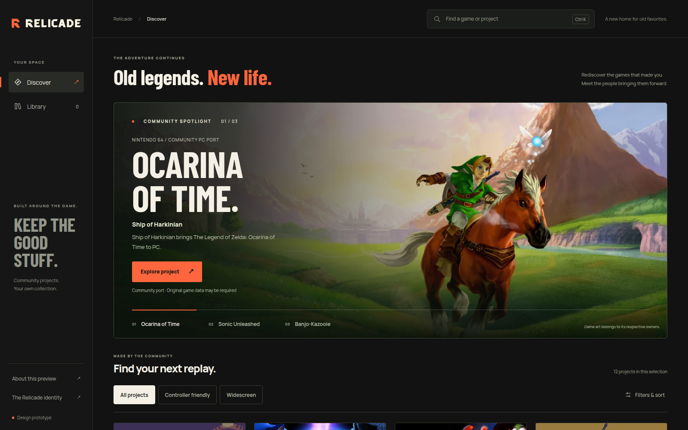

<div align="center">

# RELICADE

<picture>
  <source media="(prefers-color-scheme: dark)" srcset="brand/lockup-dark.svg">
  
</picture>

### Old legends. New life.

**A new home for games that deserve another lifetime.**

[Preview](#explore-locally) · [Product direction](docs/PRODUCT_REQUIREMENTS.md) · [Roadmap](docs/ROADMAP.md) · [Contributing](CONTRIBUTING.md)

</div>

---

## The vision

Relicade is a gamer-first launcher project for community-built PC ports, recompilations and recreations. Discover the project behind a favourite game, understand what it needs, and keep the experience together—from discovery to your library.

Power belongs underneath a clear interface, not behind missing features. Release verification, library recovery, version management, mods, controller navigation and offline access are baseline expectations. Improvements must be measurable and tested.

## Development preview

**Browser design preview and buildable native development foundation. No native launcher release yet.**

The browser preview supports a bounded selection of real public project metadata, search, filters, project details, keyboard navigation and browser-local saved-library bookmarks. Saved projects are not installed games. The browser preview does not install, update, verify or launch executables.

The separate [native foundation](native/README.md) includes .NET 10/Avalonia source, local-library persistence and synthetic/headless regressions. Linux x64 self-contained publish and isolated startup, plus Windows x64 cross-publish, are development checks only. Real game compatibility, complete functional parity, native platform acceptance and production-safe installation remain unaccepted; see the [coverage contract](docs/FEATURE_COVERAGE.md). No packaged downloads are offered.

### Interface preview



*Browser-rendered interface design preview with Ocarina of Time artwork inside the hero. This illustrates the visual design, not a native launcher release or installed-game state. Third-party artwork remains with its respective rights holders; see [NOTICE.md](NOTICE.md).*

[Identity system](brand/BRAND.md) · [Brand presentation](docs/assets/relicade-brand.png) · [Architecture](docs/ARCHITECTURE.md)

## Explore locally

Requires **Python 3.10+**. The preview itself needs no package installation, account or build step.

```sh
python tools/preview.py
```

- Product preview: <http://127.0.0.1:8766/prototype/>
- Brand presentation: <http://127.0.0.1:8766/brand/>

The server binds only to loopback, serves only the preview/brand directories, rejects directory listings and applies a restrictive content security policy. Stop it with **Ctrl+C**. Clearing browser site storage removes saved preview bookmarks.

Run the server regressions:

```sh
python -m unittest discover -s tests -v
```

See [CONTRIBUTING.md](CONTRIBUTING.md) for the full developer suite and pinned dependencies. Hosted CI is not active yet; the [workflow template](docs/ci/prototype-quality.yml) is supplied without a misleading passing-build badge.

## Platform targets

These are **release requirements, not available downloads**:

- **Windows:** x64.
- **Linux:** x64 and ARM64; AppImage and Flatpak packaging.
- **macOS:** Intel x64 and Apple Silicon ARM64.
- **Android:** APK, with mobile-specific permissions, input and application launching.

Every platform needs its own package and runtime evidence. Shared-code compilation or browser emulation does not establish native compatibility. Desktop executable launching is not an Android capability.

## What comes next

The [roadmap](docs/ROADMAP.md) prioritizes real native library and readiness flows, durable downloads, recoverable upgrades, reproducible mod profiles and controller-first navigation. These remain requirements until implementation and failure-path tests pass.

## Project structure

- `brand/` — original identity masters, usage guide, tokens and licensed fonts.
- `prototype/` — browser preview, public metadata snapshot and original project tiles.
- `native/` — shared native code, desktop/Android hosts, retained license notices and native tests; see its build instructions and limitations.
- `docs/` — product requirements, architecture, roadmap and CI template.
- `tools/` — local preview and browser QA utilities.
- `tests/` — repeatable regression checks.

## Credits and rights

Community projects, game names and external metadata belong to their respective creators and rights holders. Source links and exact provenance remain available; a catalog listing is not a download license or safety endorsement. This repository contains no ROMs, BIOS, commercial game data, user credentials or copied installed executables.

See [NOTICE.md](NOTICE.md) for third-party credits and font licenses. Inherited native source retains its applicable MIT notices. No open-source license has been selected for separately owned original Relicade material; source visibility alone is not a reuse grant.

---

<div align="center">**RELICADE** · Old legends. New life.</div>
